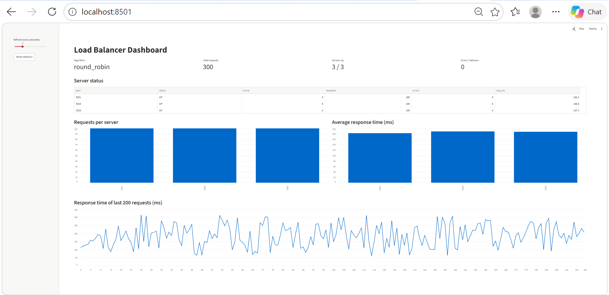
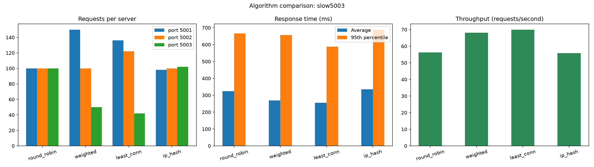

# Load Balancer for Distributed Systems

A software load balancer, built in Python, that distributes incoming traffic across multiple backend servers. It supports four balancing algorithms, automatic health checks with failover, a live monitoring dashboard, and a benchmark tool for comparing the algorithms.

## Features

- **4 algorithms:** Round Robin, Weighted Round Robin, Least Connections, IP Hash
- **Health checks:** a background thread pings every server and removes dead ones from rotation
- **Failover:** failed requests are retried on another healthy server, and recovered servers rejoin automatically
- **Live dashboard:** Streamlit page with server status, requests per server, response times and errors
- **Benchmark:** compares all algorithms under equal and uneven server conditions

## Project structure

| File | Purpose |
|---|---|
| `backend.py` | Backend server (run several on different ports) |
| `loadbalancer.py` | The load balancer (proxy, algorithms, health checks, metrics API) |
| `test_algorithms.py` | Sends N requests and prints how many each server received |
| `dashboard.py` | Streamlit monitoring dashboard |
| `benchmark.py` | Compares all algorithms and saves tables and charts |
| `screenshots/` | Output screenshots of every phase |

## Setup

```
pip install -r requirements.txt
```

## How to run

Start three backend servers, each in its own terminal:

```
python backend.py 5001
python backend.py 5002
python backend.py 5003
```

Start the load balancer, choosing an algorithm (`round_robin`, `weighted`, `least_conn` or `ip_hash`):

```
python loadbalancer.py round_robin
```

Send test traffic:

```
python test_algorithms.py 60
```

Open the dashboard:

```
python -m streamlit run dashboard.py
```

Run the benchmark (add an optional extra delay to one backend, e.g. `python backend.py 5003 0.4`, to simulate a slow server):

```
python benchmark.py equal
python benchmark.py slow5003
```

## Results

300 requests per algorithm, 20 concurrent, 3 servers.

**Equal servers**

| Algorithm | Req/s | Avg ms | P95 ms | 5001 / 5002 / 5003 |
|---|---|---|---|---|
| round_robin | 90.4 | 207.7 | 326.4 | 100 / 100 / 100 |
| weighted | 86.3 | 220.9 | 341.9 | 150 / 100 / 50 |
| least_conn | 91.2 | 209.1 | 321.7 | 105 / 104 / 91 |
| ip_hash | 92.0 | 204.5 | 324.6 | 93 / 110 / 97 |

**Server 5003 slowed down by 0.4 s**

| Algorithm | Req/s | Avg ms | P95 ms | 5001 / 5002 / 5003 |
|---|---|---|---|---|
| round_robin | 56.3 | 323.6 | 666.8 | 100 / 100 / 100 |
| weighted | 68.1 | 269.2 | 657.2 | 150 / 100 / 50 |
| least_conn | 70.0 | 255.0 | 588.1 | 136 / 122 / 42 |
| ip_hash | 55.8 | 335.1 | 688.8 | 98 / 100 / 102 |

With equal servers all four algorithms perform similarly. When one server is slow, Least Connections adapts by sending it far fewer requests (42 of 300) and gives the lowest latency and highest throughput, while Round Robin and IP Hash keep sending it a third of the traffic.

## Screenshots




## Tech stack

Python, Flask, Requests, Streamlit, Pandas, NumPy, Matplotlib